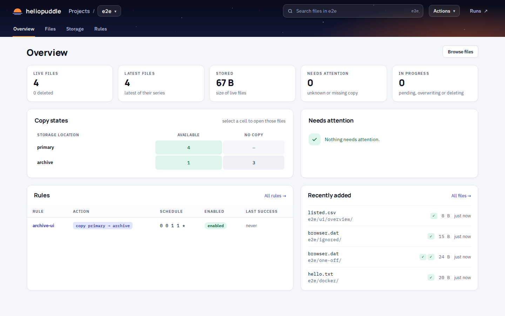
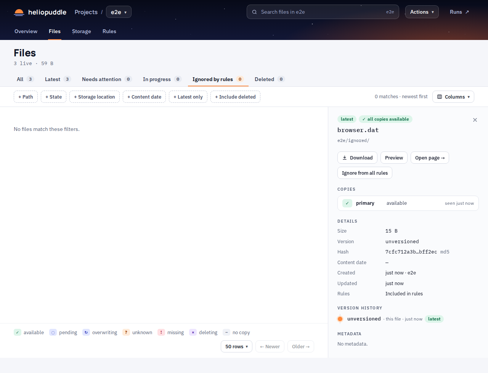
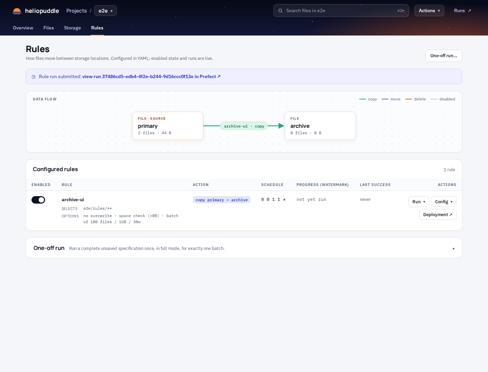

# heliopuddle

**heliopuddle** (hp) is a catalogue for a file store or datalake, with a web UI,
a command line tool and a Python client library. It indexes every file and every
copy of it across one or more storage locations (local disk, SMB, SFTP, S3,
Azure Blob, Google Cloud Storage), understands versions from file names
(`report_v12.csv` is version 12), and applies archiving rules that copy, move or
delete files. All background work runs as [Prefect](https://www.prefect.io/)
flow runs.

## Where to go next

- [Quick start](quick-start.md): install the server, the CLI and the Python client.
- [Configuration](configuration.md): the project file, with full examples of versions and rules.
- [Docker](docker.md): run the published image, with a Docker Compose example.
- [Keycloak](keycloak.md): sign in through an external OIDC provider.
- [Environment variables](environment.md): every `HELIOPUDDLE_*` setting.

## The web UI

Browse and filter files, see every copy and version, and preview CSV and CDF files:

Archiving rules show what they match and when they last ran:

