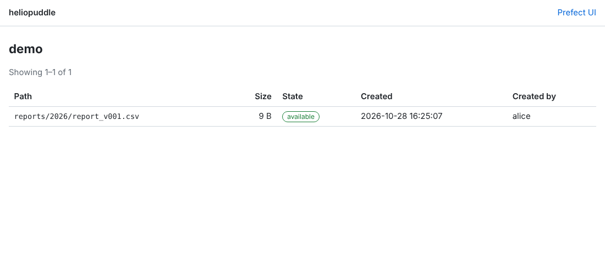

# M1 spec review and build plan (approved)

## Context

The docs (README, CLAUDE.md, `docs/spec`, `docs/design`) are pushed to the
working branch. This plan records the outcome
of the M1 spec review, the updated M1 requirements, the build steps, and the
milestone process you asked for. Nothing is built until you approve this plan.

## Review decisions

| # | Question | Decision |
|---|---|---|
| Q1 | Client bound to one project: `HelioPuddleClient(api_url, project, user=None)` | Agreed |
| Q2 | Missing user header is accepted; `created_by` is NULL (until M9) | Agreed |
| Q3 | md5 fixed for now, with a `hash_algo` column | Agreed |
| Q4 | How verification runs | **Changed:** verifying one file is a Prefect **task**, `verify_file(file_storage_location_id)`. `POST /files` calls this task **inline, in the API process, during the request**, so the response carries the final state (`available` or `unknown`). A flow, `verify_files(file_storage_location_ids)`, runs the same task over many files; it is a served deployment for background and bulk re-verification (and later index and rules). Both paths share one task, so they cannot drift apart. |
| Q5 | A location removed from YAML is marked inactive, never deleted | Agreed |
| R1 | Migrations | Migrations run by default on `server start`. `server start --no-migrate` skips them. `heliopuddle db upgrade` runs the migrations only, with no API, UI or services, then exits 0 on success (non-zero on failure). Useful as an init container or a deploy step. |
| R2 | Client/DB boundary | Enforced in CI with **import-linter** (`lint-imports`): a forbidden contract stops `heliopuddle.client` and `heliopuddle.server.ui` importing `heliopuddle.server.database`, `heliopuddle.server.models` or `sqlalchemy`. It runs in CI and in pre-commit. |
| R3 | Naming | Rename "locations" to **storage locations** everywhere. URLs: `/projects/{p}/storage-locations[/{name}]`. YAML key: `storage_locations:`. DB tables: `storage_location`, and `file_storage_location` (formerly `file_location`), with column `storage_location_id`. Python names: `StorageLocation`, `storage_location=` arguments. Concurrency names: `storage-location:
/<name>` (built as `storage-location:
:<name>`, since Prefect forbids `/` in limit names). All docs and REQ texts follow. |
| Q6 | Ports | **Changed: support both.** By default the API and UI share one port (UI at `/`, API at `/api/v1`). If `HELIOPUDDLE_UI_PORT` differs from the API port, the UI is served on its own port. The UI can also run as a separate process (`--no-api --no-services`, with `HELIOPUDDLE_UI_API_URL`). Root paths for reverse proxies are supported too. This moves UI-03 from M2 into M1. |

## Milestone process (recorded in CLAUDE.md and features.md, applies until release 1.0)

1. Review the milestone spec with you. Present it as a plan that includes a table of every in-scope requirement with its full description.
2. Once you approve, update the spec, requirements and design docs to match, and commit them.
3. Build test-first, delegated to agents with narrow briefs that cite REQ IDs.
4. Verify end to end: unit and integration suites, coverage ≥ 90%, a complete REQ matrix, `docker run`, `uv run heliopuddle server start`, a client add, the UI and the Prefect flow run.
5. Push, then **open a PR to `main`** and ask you to test.
6. **The next milestone does not start until that PR is merged to `main`.** After the merge, the branch restarts from the latest `main`, as the branch rules require.

## M1 scope (unchanged except Q4 and Q6)

- **Commands:** `heliopuddle db upgrade` runs the migrations only, then exits.
- **Server:** `heliopuddle server start [--host --port --no-api --no-ui --no-services --no-migrate]` runs the API, UI and services, plus an embedded Prefect server when `PREFECT_API_URL` is unset. The Docker image runs the same command.
- **Data:** one project with one `file://` storage location, from YAML. SQLite with alembic migrations. All files are unversioned.
- **Client:** `add_file`, `get_file`, `list_files`. **UI:** a file list page. **Tooling:** CI, `req` marker, REQ matrix script.

## M1 requirements (every in-scope requirement)

| ID | Component | Requirement (detailed) | Verified by |
|---|---|---|---|
| CLI-01 | Client | `HelioPuddleClient(api_url, project, user=None).add_file(local_path, path, storage_location=None, metadata=None)` fetches the storage-location config (URL and resolved storage options) from `GET /projects/{p}/storage-locations/{name}`, defaulting to the project's first storage location. It hashes the local file (md5, streamed) and writes it to the store with fsspec: to `path.hp-tmp` then renamed where the filesystem supports rename, else straight to the final key. It then calls `POST /projects/{p}/files` and returns a `FileRecord` (id, path, size, hash, state, created_by, location states). Because verification is inline, the returned state is already `available` or `unknown`. `get_file(id)` and `list_files()` return records. The `user` argument is sent in the configured user header. | Unit: API in-process via httpx ASGI transport, `file://` tmp location. Integration: against a running `server start`. |
| CLI-04 | Client | The client never touches the DB. It uses only HTTP to the API and fsspec to the store. An import-linter contract forbids `heliopuddle.client` importing `heliopuddle.server.database`, `heliopuddle.server.models` or `sqlalchemy`. The contract runs as its own CI job (and in pre-commit), and a violation fails CI. | `lint-imports` in CI; a unit test that `add_file` works when the client process cannot read the DB file. |
| API-01 | API | `POST /projects/{p}/files {path, storage_location, hash, size, metadata?}` validates the project, the storage location (must be active) and the path (relative, no `..`, not `*.hp-tmp`). In one transaction under a series row lock, it upserts the series (unversioned: key = path), the `file` and a `file_storage_location` in `pending`, then commits. It then **calls the `verify_file` task inline** and returns `201` with the record and its final state. `GET /projects/{p}/files` (with `limit`/`offset` paging, newest first) and `GET /files/{id}` (with per-storage-location states) return records. `created_by` is the value of the header named by `HELIOPUDDLE_USER_HEADER` (default `X-Forwarded-User`); a missing header gives NULL. Unknown project or location → `404`; invalid body → `422`. | Unit tests with a custom header name and with no header; verify runs under `prefect_test_harness`. |
| API-03 | API | `GET /projects/{p}/storage-locations` lists storage locations (name, url, accept_external_changes, active). `GET /projects/{p}/storage-locations/{name}` also returns `storage_options` with `${ENV}` values resolved from the server environment. An unset env var fails config loading at startup (see DEP-05). | Unit test with an env var in `storage_options`. |
| API-05 | API | Projects, storage locations and rules are read-only through the API: config routes expose only `GET`, and no endpoint creates, changes or deletes config. | Route-table test. |
| API-06 | API | `GET /api/v1/health` returns `200` with `{status, database, prefect}` when the DB and Prefect are reachable, else `503` naming the failing part. `GET /api/v1/version` returns the package version. | Unit tests (Prefect reachable and not). |
| DB-01 | DB | On start, `alembic upgrade head` creates the schema on SQLite: `project`, `storage_location` (incl. `active`), `series`, `file` (partial unique index on `(project_id, path)` where `deleted_at IS NULL`), `file_storage_location` (unique `(file_id, storage_location_id)`, state enum). `alembic check` reports no differences from the models. SQLite runs in WAL mode, and write transactions use `BEGIN IMMEDIATE`. | Unit test on a fresh SQLite file plus `alembic check`. |
| DB-03 | DB | On start, projects and storage locations from config are upserted into the DB by name. A storage location no longer in config is set `active = false` and never deleted; it is reactivated if it returns. | Unit test that changes config between two starts. |
| DB-04 | DB | `heliopuddle server start` runs migrations by default; `--no-migrate` skips them. If the schema is then not at head, startup fails with a clear message. `heliopuddle db upgrade` runs the migrations only, starts no API, UI or services, and exits 0 on success and non-zero on failure. | Unit tests via the CLI runner: fresh DB, already at head, a failing migration, and `--no-migrate` against an old schema. |
| STO-01 | Storage | The storage-location wrapper `StorageLocation(url, storage_options)` provides `open_read`, `write` (temp then rename where supported), `md5` (streamed, 8 MiB chunks), `info` (size, mtime), `exists` and `rm` on a `file://` storage location. It also works on `memory://` for tests. | Unit tests on `file://` and `memory://`. |
| SVC-01 | Services | `server start` registers and serves the services' deployments (`verify_files` in M1) with `prefect.serve()`. When `PREFECT_API_URL` is unset, it starts an embedded Prefect server child process (`PREFECT_HOME` under the data dir), waits for `/health`, and stops it on exit. When `PREFECT_API_URL` is set and `{url}/health` fails, startup exits non-zero with a clear message. | Integration tests for both cases. |
| SVC-02 | Services | The Prefect task `verify_file(file_storage_location_id)` re-hashes the copy in the store. On a match with the registered hash it sets `available` and records size, mtime, hash and `last_seen_at`; on a mismatch or a missing file it sets `unknown`. The API calls it inline during register. The flow `verify_files(file_storage_location_ids)` runs the same task for many files and is a served deployment. Given the same copy, both paths give the same result. | Unit tests for the task (match, mismatch, missing) under `prefect_test_harness`; the flow over several files; an integration test submitting the deployment. |
| UI-01 | UI | `GET /` (project picker when there are several, else the project) shows the file list: path, size, state, created_at, created_by, with paging. It links to the Prefect UI (`HELIOPUDDLE_PREFECT_UI_URL`, derived from `PREFECT_API_URL` by default). | FastAPI test client; e2e Playwright screenshot. |
| UI-03 | UI | The UI can be served three ways: (a) on the API's port at `/` (default); (b) on its own port, `HELIOPUDDLE_UI_HOST`/`HELIOPUDDLE_UI_PORT`, in the same process; (c) as a separate process with `--no-api --no-services`, talking to `HELIOPUDDLE_UI_API_URL`. `HELIOPUDDLE_UI_ROOT_PATH` and `HELIOPUDDLE_API_ROOT_PATH` set root paths for reverse proxies. *(Moved from M2.)* | Integration test for each mode, plus one with root paths. |
| UI-05 | UI | The UI reads data only through `heliopuddle.client`, never the DB or `server.models`. The import-linter contract in CI covers `heliopuddle.server.ui`. | `lint-imports` in CI. |
| DEP-01 | Deploy | `docker run` with volumes `/data`, `/config` and `/var/lib/heliopuddle` runs the API, UI, services and embedded Prefect as a non-root user under `tini`. `/api/v1/health` returns `200`, and a client add from the host works end to end. | e2e test building and running the image. |
| DEP-02 | Deploy | `uv run heliopuddle server start` behaves the same as the container. `--no-api`, `--no-ui`, `--no-services` and `--no-migrate` turn parts off, and `--host`/`--port` override settings. | Integration test. |
| DEP-05 | Deploy | Invalid settings or project config (bad YAML, schema errors, duplicate names, unset `${ENV}`, a project with no location) stop startup with a clear message naming the file and field, and a non-zero exit code. | Unit tests. |

Changes from the pushed docs:
- CLI-01, API-01 and SVC-02 are reworded for inline verification with a task.
- DB-04 (migration commands) is new.
- CLI-04 and UI-05 are now enforced by import-linter in CI.
- UI-03 moves to M1, and "separate UI process" leaves the M1 out-of-scope list.
- "location" is renamed "storage location" in every doc, the README samples and every REQ (including later milestones).
- The design docs (architecture, data-model, operations, indexing, rules, deployment) are updated to match.

## Steps after approval

1. **Docs commit:** update `README.md`, `docs/spec/features.md` (M1 scope, review decisions, the process section, open questions resolved), every file in `docs/spec/requirements/` and `docs/design/` (the decisions above plus the storage-location rename), and add a "Milestone process (until 1.0)" section to `CLAUDE.md`. Commit and push.
2. **Scaffold (done by me, so agents share one base):** `pyproject.toml` (uv, hatchling, deps: fastapi, uvicorn, sqlalchemy, alembic, pydantic-settings, pyyaml, httpx, fsspec, prefect, jinja2, typer; dev: import-linter), the package skeleton, the `req` pytest marker in `tests/conftest.py`, `scripts/req_matrix.py`, ruff/pyright config, the import-linter contracts, and `examples/projects/demo.yaml`. Commit.
3. **Parallel agents in worktrees, each test-first with its REQ IDs:**
   - A: settings, config loader, DB, migrations, models, API (API-01/03/05/06, DB-01/03/04, DEP-05).
   - B: storage, client (STO-01, CLI-01/04).
   - C: services, Prefect runtime, CLI (SVC-01/02, DEP-02).
   - D: UI (UI-01/03/05).
   - E: Docker, CI and e2e (DEP-01).
   The schemas in `server/schemas` are written in step 2, so the agents share one contract.
4. **Integrate** the agents' work and fix any seams.
5. **Verify** as below, then push and open the PR to `main`. Then stop for your testing; M2 does not start until the PR is merged.

## Verification

- `uv run ruff check .`, `uv run pyright`, `uv run lint-imports`.
- `uv run heliopuddle db upgrade` on a fresh DB exits 0; `server start --no-migrate` on an old schema fails clearly.
- `uv run pytest tests/unit --cov --cov-fail-under=90`, then `uv run pytest tests/integration`.
- `uv run python scripts/req_matrix.py`: every M1 requirement has a passing test.
- Manual: `uv run heliopuddle server start` with `examples/projects/demo.yaml`. A client `add_file` returns `available`, and the file is in the store. The UI list shows it (Playwright screenshot) in both the shared-port and own-port modes. The Prefect UI shows the `verify_file` task run (inline) and a `verify_files` deployment run.
- `docker build` plus `docker run` with volumes: health is OK and a client add works.

