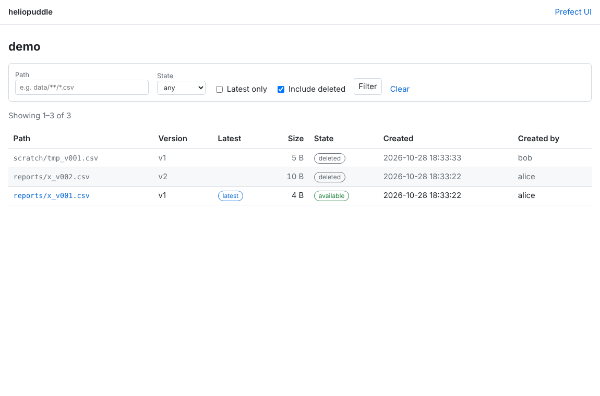
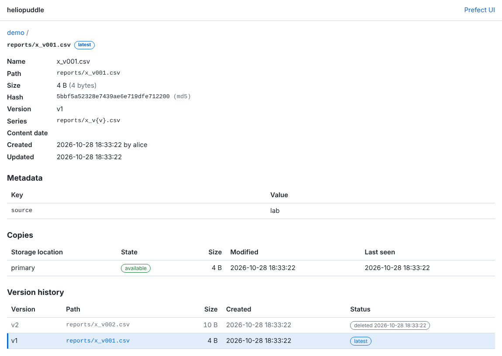

# M2 spec review and build plan (approved)

## Context

M1 (walking skeleton) is merged to `main`. In M1 every file is unversioned, re-registering a path silently overwrites it, there is no remove, the only queries are list and get, and only SQLite is supported. M2 adds:

- server-derived versions and series with a correct `is_latest`;
- idempotent re-adds and conflict handling;
- removal;
- real queries in the API, the client and the UI;
- Postgres, alongside an external Prefect server.

Under the milestone process, nothing is built until you approve this plan.

## Proposed decisions for review

| # | Topic | Proposal |
|---|---|---|
| D1 | Remove | Same pattern as verify. Deleting one file is a Prefect **task**, `delete_file(file_id)`. `DELETE /files/{id}` calls it **inline**: copies go `deleting` → store delete → `deleted`, `file.deleted_at` is set, and `is_latest` is recomputed under the series lock. The response is the final record. A `delete_files(file_ids)` flow runs the same task and is served as the deployment `delete_files/delete-files` for bulk use. If the store delete fails, the copy is left `deleting` (later index or rerun repairs) and the API returns 200 with that state. |
| D2 | Series keys | Single-number versions and major/minor versions never share a series. Single: the version digits are replaced by `{v}` (`a_v{v}.cdf`). Major/minor: replaced by `{major}.{minor}` (`a_v{major}.{minor}.cdf`). Unversioned: the key is the path. |
| D3 | Idempotent re-add | `POST /files/check {path, hash}` returns `{exists, hash_matches, file}`. The client skips the transfer **only if** the hash matches and the copy is `available`. Otherwise (missing, or `pending`/`unknown`) it writes and registers again, which re-verifies. A register with the same hash at a live path returns **200** with the existing record and re-verifies only if the copy is not `available`. |
| D4 | Conflict | A different hash at a live path → `409` with the existing record, unless `overwrite=true`. With overwrite, the same file row is updated: new hash and size, `created_by` kept, `updated_at` and new `updated_by`, then re-verified. The version is unchanged because the path is unchanged. The client checks **before** writing, so a conflict never touches the store. |
| D5 | Re-adding a deleted path | Creates a new file row. Deleted rows stay as history; paths are unique only among live files. |
| D6 | Content date | Optional `content_date` in register. If the client gives none, it is taken from a `date` named group in the version rule (ISO `YYYY-MM-DD` or `YYYYMMDD`). It can be filtered. |
| D7 | Path-scoped routes | Project-scoped: `GET /projects/{p}/files/by-path?path=`, `POST /projects/{p}/files/check`. Id-scoped: `GET /files/{id}`, `DELETE /files/{id}`, `PATCH /files/{id}/metadata`, `GET /series/{id}/versions`. |
| D8 | SQLite locking | Reads use plain deferred transactions. Only write transactions use `BEGIN IMMEDIATE` (via a `write_session()` helper). This replaces M1's "every transaction is IMMEDIATE". Postgres uses `SELECT ... FOR UPDATE` on the series row. |
| D9 | Metadata patch | `PATCH /files/{id}/metadata` takes a JSON object. It is a shallow merge by default; `?replace=true` replaces the whole object. A `null` value removes a key. |
| D10 | `updated_by` | Add an `updated_by` column (user header) for overwrite, metadata changes and deletes. This needs migration `0002`. |

## M2 requirements (every in-scope requirement)

| ID | Component | Requirement (detailed) | Verified by |
|---|---|---|---|
| API-02 | API | The series and version are derived by the server from the path, using the project's `versioning` rules: first match wins; the two defaults (`v<major>.<minor>.<ext>` then `v<version>.<ext>`, 1–10 digits) are appended; no match means unversioned. Series keys follow D2. Within a series, `is_latest` is true for exactly one live file: the highest `(major, minor)` for `latest_by: major_minor` (the default), the highest `minor` for `latest_by: minor`, or the highest `version`. Leading zeros are ignored. It is recomputed in the same transaction as every add, overwrite and remove, under the series row lock, and `series.latest_file_id` is kept in step. Unversioned files are always latest. `content_date` follows D6. | Table-driven unit tests over the examples in `docs/design/versioning.md`; add/remove sequences checking `is_latest` and `latest_file_id`. |
| API-07 | API | `POST /projects/{p}/files/check {path, hash}` returns `{exists, hash_matches, file}`. `GET /projects/{p}/files/by-path?path=` returns the live file or 404. Register with the same hash at a live path → 200 with the existing record (D3). A different hash → `409` with the existing record in the body, unless `overwrite=true` (D4). | Unit tests. |
| API-08 | API | `DELETE /files/{id}` removes the file inline (D1) and returns the final record; deleting an already-deleted file returns 404. `PATCH /files/{id}/metadata` merges or replaces metadata (D9) and sets `updated_by`. | Unit tests, including deleting the latest version and the previous version becoming latest. |
| API-09 | API | `GET /projects/{p}/files` filters: `path` (glob with `*`, `**`, `?`; narrowed in SQL with a `LIKE` prefix, then matched exactly in Python before paging), `series_id`, `latest_only`, `state`, `storage_location`, `content_date_from`/`content_date_to`, `include_deleted` (default false), `limit`/`offset`, `order` (`created_at` descending by default, or `path`). `total` counts after filtering. `GET /series/{id}/versions` returns every live version, newest version first, and with `include_deleted` also deleted ones. | Golden-dataset unit tests, one per filter and in combination; paging totals. |
| CLI-02 | Client | Re-adding a file whose hash matches an `available` copy at that path makes no write to the store and no register call, and returns the existing record. | Spy on `StorageLocation.write`; the store mtime is unchanged. |
| CLI-03 | Client | `remove_file(path_or_id)`, `find(path=None, latest_only=False, state=None, storage_location=None, content_date_from=None, content_date_to=None, include_deleted=False, limit, offset)`, `list_versions(path_or_series_id)` and `latest(path)` (the latest live version in the series containing `path`) return the correct records. `find_all(...)` iterates over every page. | Golden set of versioned files against the in-process API. |
| CLI-05 | Client | `add_file(..., overwrite=False)` checks first. On a conflicting hash it raises `ConflictError(existing)` without touching the store. With `overwrite=True` it writes and registers with `overwrite=true`, and the record has the new hash. | Unit tests. |
| CLI-06 | Client | `open(path)` returns a binary file object read directly from the store; `download(path, dest)` streams to a local file and checks the md5 against the record (raising `IntegrityError` on mismatch). Both use the storage-location config from the API and the first `available` copy. | Unit tests. |
| DB-01b | DB | The same alembic migrations (`0001` plus new `0002`) run on Postgres, and the schema matches the models (`alembic check` is clean) on both SQLite and Postgres. | Integration test with a Postgres testcontainer. |
| DB-02 | DB | Concurrent registrations and removals in one series (threads, each with its own session) leave exactly one live `is_latest` file, `series.latest_file_id` pointing at it, and unique live paths. This holds on SQLite (`BEGIN IMMEDIATE` writes, D8) and on Postgres (`FOR UPDATE`). | Concurrency tests: unit on SQLite, integration on Postgres. |
| SVC-07 | Services | The task `delete_file(file_id)` marks every copy `deleting`, deletes each from its storage location (a missing object counts as deleted), marks copies `deleted`, sets `file.deleted_at` and `updated_by`, and recomputes `is_latest`. The `delete_files` flow runs it over many files and is a served deployment. | Unit tests (task, flow); integration test submitting the deployment. |
| UI-02 | UI | The file detail page `/projects/{p}/files/{id}` shows path, size, hash, content date, created and updated by, metadata, the state of each copy per storage location, and the version history of its series (newest first, the latest marked, deleted versions greyed out). Paths in the list link to it. | Unit tests with the stub client. |
| UI-06 | UI | The file list has filters for a path glob, latest only, state and include deleted, as GET query parameters that work without JavaScript, and paging keeps them. | Unit tests. |
| DEP-04 | Deploy | With only env vars set (`HELIOPUDDLE_DATABASE_URL=postgresql+psycopg://...`, `PREFECT_API_URL=<external server>`), `server start` migrates Postgres, registers both deployments with the external Prefect, serves them, and a client add, remove and verify-deployment run work end to end. | Integration test with Postgres and `prefecthq/prefect:3.9` containers. |
| DEP-06 | Deploy | `versioning` rules are validated at startup: the regex compiles; it has a `version` group, or `major` with an optional `minor`, but not both; `latest_by` is valid; `paths` globs are non-empty. An invalid rule stops startup naming the file, rule index and field. | Unit tests. |

**Still passing from M1:** all M1 requirements, and the M1 e2e Docker tests.

## Design and doc updates (the docs commit)

- **`features.md`:** the M2 section matches this plan, with M2 marked "building".
- **Requirements:** API-08 narrowed to delete and metadata, and new API-09, UI-06 and DEP-06 in `docs/spec/requirements/*.md`.
- **`versioning.md`:** series keys (D2), `content_date` from the `date` group (D6), and validation (DEP-06).
- **`operations.md`:** idempotent re-add, conflict and overwrite order (D3, D4), and the inline delete (D1).
- **Other design docs:** `data-model.md` (`updated_by`, migration 0002), `architecture.md` (locking, D8) and `deployment.md` (Postgres, external Prefect, `delete-files`).
- **Review record:** this plan saved as `docs/spec/reviews/m2-plan.md`.

## Build steps

0. **Restart the branch:** reset the working branch to the latest `origin/main`, then force-with-lease push. The branch holds only already-merged history, so nothing is lost.
1. **Docs commit**, as above. Set `[tool.heliopuddle] milestone = "M2"`.
2. **Scaffold by me** (the shared contracts):
   - API schemas: `FileCreate.overwrite` and `content_date`, `FileCheck`/`FileCheckResult`, `MetadataPatch`, list filter params, `SeriesVersions`;
   - the `VersionRule` config model;
   - `versioning.py` (pure: `derive(path, rules) -> VersionInfo`), with its table-driven tests;
   - ORM `updated_by` and migration `0002`;
   - the `psycopg[binary]` dependency.
3. **Agents in parallel worktrees, test-first:**
   - **A, models and API:** `series`/`is_latest`, register semantics, check, by-path, conflict, delete task inline, metadata, queries, D8 `write_session`. Owns API-02/07/08/09, SVC-07 (task and flow), DB-02 (SQLite) and DEP-06.
   - **B, client:** owns CLI-02/03/05/06.
   - **C, Postgres and runtime:** Postgres engine support, the `delete-files` deployment, and integration tests for DB-01b, DB-02 (Postgres), DEP-04 and SVC-07 (deployment).
   - **D, UI:** owns UI-02 and UI-06.
4. **Integrate** the agents' work, then extend the e2e tests: Docker add a versioned file, add a new version, then UI detail screenshot.
5. **Verify** (below), push, and **open the M2 PR to `main`**. Then stop for your testing; M3 does not start until it is merged.

## Verification

- `uv run ruff format --check . && uv run ruff check . && uv run pyright && uv run lint-imports`.
- `uv run pytest tests/unit --cov=heliopuddle --cov-fail-under=90 --req-report=.reports/req-unit.json`.
- `uv run pytest tests/integration` (Postgres and Prefect containers).
- The Docker e2e tests.
- `scripts/req_matrix.py` with milestone M2: every M1 and M2 requirement passes.
- **Manual run:** `server start` on SQLite. Add `x_v001.csv`, then `x_v002.csv`; `latest` and `list_versions` are correct. Re-adding `v002` is a no-op. A conflicting re-add raises `ConflictError`. `remove_file(v002)` makes `v001` latest. The UI detail page shows the history (screenshot).
- **Then the same on Postgres with an external Prefect container:** `docker run postgres`, `prefect server`, then hp configured by env vars only.

