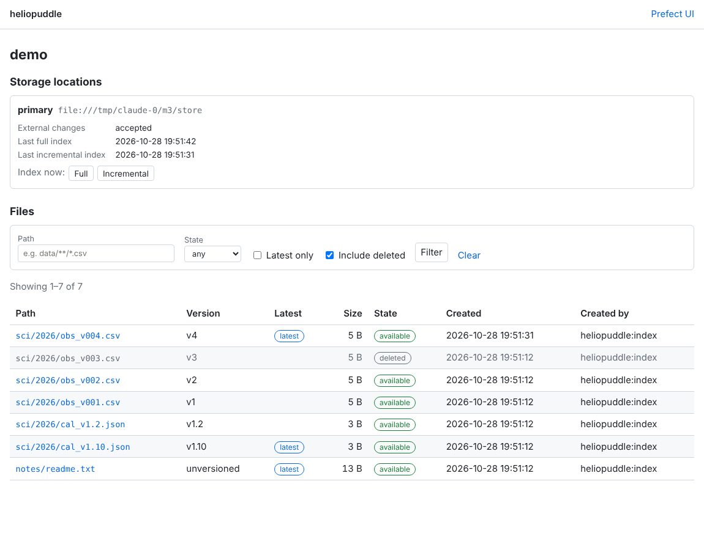

# M3 spec review and build plan (approved)

## Context

M2 is merged. Today hp only knows about files that clients register. M3 makes the DB follow what is actually in each storage location:

- an existing folder or bucket is adopted by a full index;
- files added, changed or removed directly in the store are picked up by full and incremental index flows, which run on schedules and on demand;
- Azure Blob works, tested against Azurite, and runs in the Docker image.

You decided two points during this review:

- **Unknown files are recorded but never latest.** Any copy in state `unknown` can be **accepted** by an operator, which makes its current content the accepted state.
- **Index work is split into Prefect tasks by batch.** The batch size is a project setting, `index.batch_size`, and defaults to **1**.

## Decisions

| # | Topic | Decision |
|---|---|---|
| D1 | Task granularity | The index flows list the store, then run one Prefect task, `index_batch`, per `index.batch_size` listed entries (project setting, default **1**). Hashing happens inside the batch task. CLAUDE.md is updated: per-file work is a task, and index flows batch it by `index.batch_size`. |
| D2 | Unknown files | In a storage location with `accept_external_changes: false`, a file the DB has never seen gets a `file` row plus a copy in state `unknown`. It shows in the API and UI. |
| D3 | Latest eligibility | Changes M2's rule. A live file can be `is_latest` only if at least one of its copies is `pending` or `available`. A file whose copies are all `unknown`, `missing`, `deleting` or `deleted` is never latest. If no file in a series is eligible, `latest_file_id` is NULL. |
| D4 | Accept | `POST /files/{id}/accept {storage_location?}` accepts any `unknown` copy as it is now. It re-hashes the copy, sets the file's hash and size from it, sets the copy `available`, sets `updated_by`, and recomputes `is_latest`. The default storage location is the file's only `unknown` copy. Client `accept_file`; a UI button on the detail page. |
| D5 | Settle time | Files modified less than `index.settle_time` ago (default `60s`) are skipped and picked up next run. This avoids racing a client that has written a file but not yet registered it. |
| D6 | Hashing | md5. The backend's own md5 is used where it has one (Azure `content_md5`, and S3 ETag for non-multipart uploads); otherwise the file is read and hashed. |
| D7 | Incremental | `index_incremental` processes only files with mtime after the watermark minus an overlap (`index.incremental_overlap`, default `5m`). Listing is limited to `index.incremental_prefixes` when set. These are strftime templates expanded over `index.incremental_lookback` (default `2d`), e.g. `science/{date:%Y/%m/%d}`. Otherwise the whole storage location is listed. Removals are detected only by `index_full`. |
| D8 | System user | The indexer writes `created_by` and `updated_by` as `heliopuddle:index`. |
| D9 | Deployments and schedules | Each project and storage location gets the deployments `index-full-
-<sl>` and `index-incremental-
-<sl>`, scheduled from the project's `index.full_schedule` and `index.incremental_schedule` (cron; either may be omitted). On start, hp deletes index deployments it no longer has config for. |
| D10 | Adoption on first start | After the services are serving, hp submits an `index_full` run (`run_deployment(timeout=0)`) for each active storage location that has no `last_full_at`. |
| D11 | Concurrency | Both index flows hold `hp_concurrency("storage-location:
:<sl>")`. A full index waits for the lock (`index.lock_timeout`, default `1h`). An incremental index **skips** if the lock is busy and returns a "skipped" summary. |
| D12 | Repair | A full index re-verifies `pending` copies older than `index.reverify_after` (default `1h`) with `verify_file`. It retries `deleting` copies older than the same threshold with `delete_file`. |
| D13 | Run summary | Each index flow returns counts: listed, added, changed, removed, missing, unknown, skipped, reverified. It also publishes a Prefect markdown artifact. `index_progress` is updated only on success. |
| D14 | Run endpoint | `POST /projects/{p}/runs {kind: "index", storage_location, mode: "full" \| "incremental"}` returns `202 {flow_run_id, flow_run_url}`. API-04 (M4) later adds rules and reconcile to the same endpoint. |

## M3 requirements (every in-scope requirement)

| ID | Component | Requirement (detailed) | Verified by |
|---|---|---|---|
| SVC-03 | Services | **`index_full(project, storage_location)`** streams a listing of the whole storage location and diffs it against the DB in batches of `index.batch_size` (D1). It is the only flow that detects removals. • `accept_external_changes: true`: &nbsp;&nbsp;– **new file:** added with its version from the path rules, hashed (D6), copy `available`, `created_by` `heliopuddle:index`; &nbsp;&nbsp;– **same size and mtime:** `last_seen_at` updated; &nbsp;&nbsp;– **size or mtime changed:** re-hashed; if the hash changed, the file's hash and size are updated and the copy stays `available`; &nbsp;&nbsp;– **in the DB but gone from the store:** copy `deleted`; the file is soft-deleted when it has no live copies left, and latest is recomputed. • `accept_external_changes: false`: new → recorded `unknown` (D2), changed → `unknown`, gone → `missing`. • Skipped: `*.hp-tmp`, files inside the settle time (D5), and `pending`/`deleting` copies younger than `reverify_after`. • Adopting an existing tree of files of any size gives every file a correct version, series and latest. | Unit tests on `file://` covering every row of the diff table in both modes, with batch sizes 1 and 3; integration tests on Azurite. |
| SVC-08 | Services | **`index_incremental(project, storage_location, since=None)`**: as D7, using the watermark `index_progress.last_incremental_at` (or `since`). It applies the same add and change rules as the full index, never marks anything removed, and advances the watermark only on success. | Unit tests: watermark, overlap, prefix templates and lookback, no removals. |
| SVC-09 | Services | **Deployments, schedules and adoption:** • one full and one incremental deployment per active storage location (D9), with cron schedules from config; • stale index deployments are removed on start; • adoption runs on first start (D10); • concurrency follows D11: full waits, incremental skips; • the run summary and artifact follow D13. | Unit tests (deployment specs, cron validation); integration tests (embedded Prefect: deployments and schedules registered, adoption run completes on start, a skipped incremental run while a full one holds the lock). |
| SVC-10 | Services | **Repair:** a full index re-verifies stale `pending` copies and retries stale `deleting` copies (D12), using the existing `verify_file` and `delete_file` tasks. | Unit tests. |
| API-10 | API | **Index run endpoint:** • `POST /projects/{p}/runs {kind: "index", storage_location?, mode}` validates the input (unknown storage location → 404; inactive → 409; bad mode or kind → 422) and submits the deployment run without waiting; • it returns `202 {flow_run_id, flow_run_url}`; • the default storage location is the project's first; • `GET /projects/{p}/storage-locations[/{name}]` now also returns `last_full_index_at` and `last_incremental_index_at`. | Unit tests (with run submission mocked); integration test (real Prefect). |
| API-11 | API | **Accept:** `POST /files/{id}/accept {storage_location?}` works as D4. It returns `404` for an unknown or deleted file and `409` if the copy is not `unknown`. It is recorded with `updated_by`. | Unit tests, including accepting makes the file eligible for latest. |
| API-12 | API | **Latest eligibility** (D3, which amends API-02): `is_latest` and `latest_file_id` consider only live files with at least one `pending` or `available` copy. This is recomputed whenever a copy's state changes the result: verify, index, accept, delete. | Table tests over state combinations; series with no eligible file. |
| CLI-07 | Client | `trigger_index(storage_location=None, mode="full") -> RunInfo` and `accept_file(path_or_id, storage_location=None) -> FileRecord`. | Unit tests against the in-process API. |
| STO-02 | Storage | `StorageLocation` works on Azure Blob (`az://container/prefix`, adlfs): write with no rename step, read, md5 (native `content_md5` when present, otherwise read back), `info` (size, mtime from `last_modified`), `exists`, `rm`, and a streamed listing with detail for the indexer. Storage options come from config (`connection_string` or `account_name`/`account_key`) via `${VAR}`. | Integration tests against Azurite (`mcr.microsoft.com/azure-storage/azurite`). |
| UI-07 | UI | **Project page:** a storage-locations panel showing the URL, whether external changes are accepted, the last full and incremental index times, and an "Index now" button (full and incremental) that posts a run and links to it in Prefect. **File detail page:** an "Accept as is" button for each `unknown` copy. **Badges:** files whose only copies are `unknown`/`missing` are labelled "not latest-eligible". | Unit tests with the stub client. |
| DEP-03 | Deploy | The same container works with an Azure (Azurite) storage location in place of a volume, configured by env vars: adoption of pre-existing blobs on start, a client add (written straight to Azurite) ending `available`, and a blob deleted directly being picked up by a full index. | e2e test with Azurite plus the image. |
| DEP-07 | Deploy | The project `index` config is validated at startup: cron expressions parse, `batch_size ≥ 1`, durations parse, and prefix templates use only `{date:...}`. An invalid value stops startup and names the file and field. | Unit tests. |
| DB-05 | DB | Migration `0003` adds `index_progress` (storage_location_id PK, `last_full_at`, `last_incremental_at`). The schema matches the models on SQLite and Postgres. | Unit test (SQLite); integration test (Postgres). |

All M1 and M2 requirements must still pass.

## Out of scope

Copy, move and delete rules; multiple storage locations working together (M4); reconcile (M5); changing a file's series after its version rules change.

## Build steps

0. **Restart the branch** from the latest `origin/main` and force-with-lease push. The branch holds only merged history.
1. **Docs commit:**
   - `features.md`: the M3 section, the decisions above, and the status set to building.
   - Requirements: SVC-03 rewritten; SVC-08/09/10, API-10/11/12, CLI-07, UI-07, DEP-07 and DB-05 added; STO-02 and DEP-03 detailed.
   - Design docs:
     - `indexing.md` (rewritten);
     - `data-model.md` (`index_progress`, eligibility);
     - `versioning.md` (eligibility);
     - `operations.md` (accept);
     - `deployment.md` (index deployments, Azure and Azurite);
     - `architecture.md`.
   - CLAUDE.md: the batch exception (D1).
   - `docs/spec/reviews/m3-plan.md`, and the milestone set to M3.
2. **Scaffold, done by me:**
   - an `IndexConfig` model (with validation, DEP-07) on `ProjectConfig.index`;
   - API schemas: `RunRequest`, `RunInfo`, `AcceptRequest`, and the index times on `StorageLocationRead`;
   - the `IndexProgress` table and migration `0003`;
   - the `adlfs` dependency;
   - a `StorageLocation.walk()`/`list_files()` interface stub with an entry type.
3. **Agents in parallel, test-first:**
   - **A, index services:** the `index_full`/`index_incremental` flows, the `index_batch` task, the diff rules, repair, `index_progress`, the run summary and artifact, D3 in `recompute_latest`, and the accept model function. Owns SVC-03/08/10, API-12 and DB-05.
   - **B, API, client and UI:** the runs endpoint, the accept endpoint, index times, `trigger_index`/`accept_file`, and UI-07. Owns API-10/11, CLI-07 and UI-07. Builds against A's model functions, which are stubbed in the scaffold.
   - **C, Azure and runtime:** STO-02 (Azurite fixtures), the deployment specs and schedules, stale-deployment cleanup, adoption on start, the D11 concurrency behaviour, and DEP-03 in Docker. Owns STO-02, SVC-09, DEP-03 and DEP-07 (startup).
4. **Integrate, then verify** (below). Push and **open the M3 PR**, then stop for your testing.

## Verification

- `ruff`, `pyright` and `lint-imports`.
- Unit tests at ≥90% coverage, the integration suite (Postgres, external Prefect, Azurite) and the Docker e2e tests, including the Azurite variant.
- `req_matrix.py` for M3: every M1–M3 requirement passes.
- **Manual run:**
  1. Put a tree of versioned files into a local folder, then `server start`: the adoption run completes in Prefect, and the UI lists every file with the correct latest.
  2. Drop a new file into the store, change one and delete one, then run an incremental index (picks up the new and changed files) and a full index (picks up the removal).
  3. Set `accept_external_changes: false` and drop in a file: it appears as `unknown` and not latest. Accept it in the UI: it becomes `available` and latest.
  4. "Index now" from the UI works.
  5. Repeat with an Azurite storage location in Docker.

