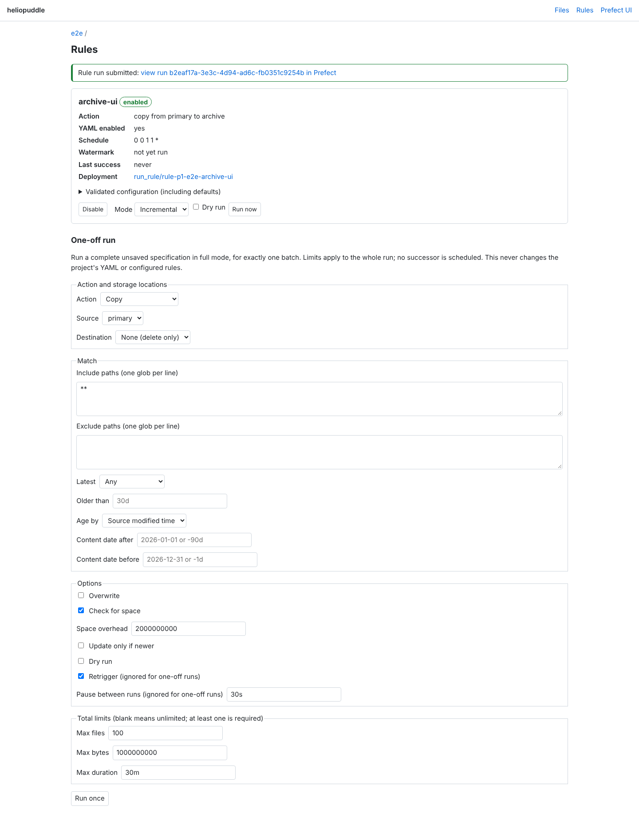
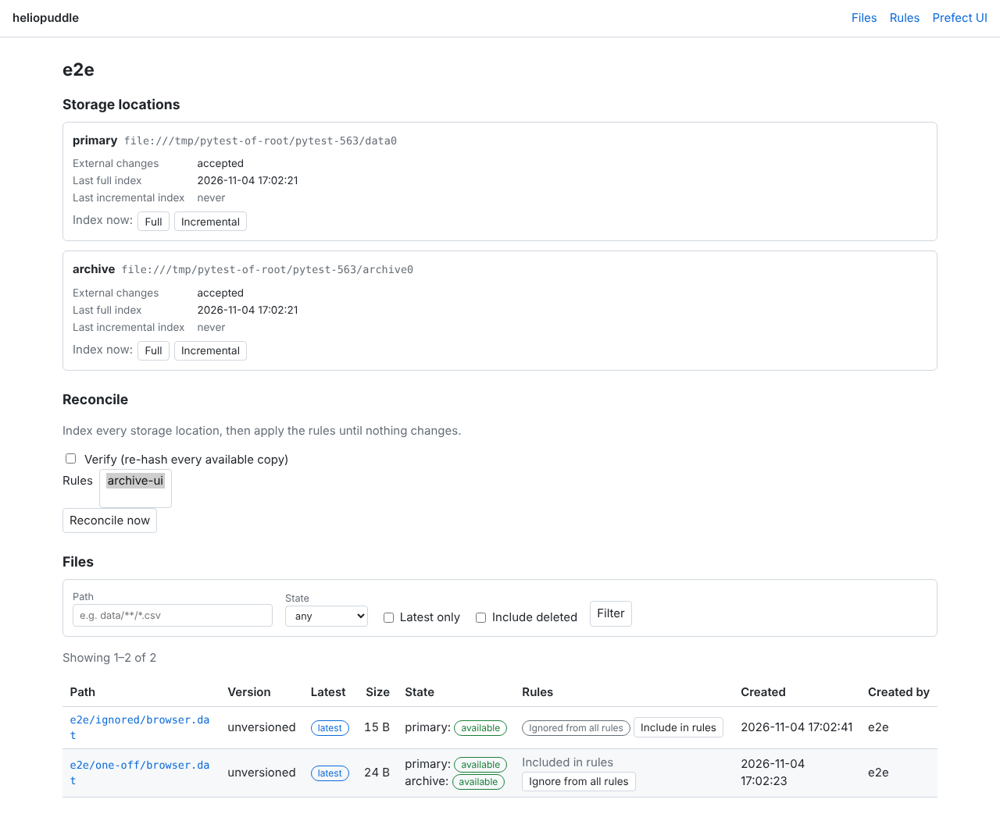

# M4 plan: multiple storage locations, archiving rules, batched runs

## Context

M3 is merged (`main` at `5c187ec`). M4 adds YAML archiving rules that `copy`, `move` or `delete` files between a project's storage locations. Every run, rule or index, is bounded by batch limits and chains itself when work remains.

Other additions:

- one-off runs from the UI and API;
- enable and disable switches for rules;
- an "ignore from all rules" flag on files;
- best-effort rule triggering when files change.

Everything builds on the M3 ownership contract in `docs/design/operations.md`:

- tokens, guarded transitions, staged publication and safe delete;
- copy and move are new operations under that contract;
- the M3 adversarial invariants extend to them.

## Decisions

| # | Topic | Decision |
|---|---|---|
| R1 | Rule `delete` scope | A rule `delete` removes only the file's copy in the rule's **source** storage location, through the M3 guarded delete applied to one copy. The file is soft-deleted when no live copies remain. |
| R2 | Source during copy/move | The source is not locked for the whole transfer. The transfer records the source copy's `(generation, hash)` when it starts and verifies the destination against that hash. A move deletes the source only through the guarded delete with that generation and hash, so a source changed mid-transfer is never deleted. |
| R3 | Destination writes | The destination is owned with a renewable token. With no object at the path it is written directly; otherwise it is staged and published (M3 procedure). A same-filesystem transfer uses `fs.copy`; the capability is decided in `backends.py`. Otherwise the content is streamed. Expired transfer tokens are repaired by the full index, as uploads are. |
| R4 | Destination already has the file | **Same hash:** the destination copy is marked `available`; nothing is written. **Different hash, `update_only_if_newer` set and the destination is newer:** skip. **Different hash, `overwrite` set:** replace. **Different hash otherwise:** the destination becomes `unknown`, the file is skipped, and the skip is reported in the log. |
| R5 | `check_for_space` (all backends) | `backends.free_space(fs, path) -> int \| None`, natively: local via `shutil.disk_usage`; SMB via the volume-size query; SFTP via the `statvfs@openssh.com` extension.  New optional storage-location setting `quota` (e.g. `500GB`), usable on any backend: available space = quota minus the indexed size on that storage location.  Object stores with no quota are unlimited. When both a native value and a quota exist, the smaller wins.  Defaults: `check_for_space: true`, `check_for_space_overhead: 2GB`. Sizes accept `1GB`, `500MB` and similar. |
| R6 | `age_by: modified` | Measured from the source copy's store `mtime`, falling back to the file's `created_at`. `age_by: content_date` uses `content_date`; a file without one never matches an age criterion. |
| R7 | Latest changes | A change to `is_latest` counts as an update: `recompute_latest` sets `updated_at` on each file whose flag flips. The data-model sentence "changing `is_latest` does not touch `updated_at`" is removed. |
| R8 | Incremental selection | Candidates are files or copies updated since the watermark, plus files whose age crossed `older_than` since then. Incremental runs walk candidates in keyset order `(updated_at, id)`. The watermark is that pair, so files sharing a timestamp across a batch boundary are never skipped (new requirement SVC-22). The first incremental run behaves as full. |
| R9 | Batch limits (all runs: rule and index) | Limits are `batch.max_files` (default 100), `batch.max_bytes` (default `1GB`) and `batch.max_duration` (default `30m`). Any combination may be set; a run stops at the first limit reached, after finishing the current file.  Rules set them per rule, index runs per project (`index.batch`). For index runs, bytes count only content actually read for hashing.  Progress is saved after each completed batch. Index full runs keep the chain's start time so removals are detected only when the last batch of the chain finishes. |
| R10 | Retrigger | If an incremental or full run still has work when it stops (it re-queries after the batch), it schedules the next run of the same deployment before finishing. The next run starts `pause_between_runs` later (default `30s`) and carries the cursor.  `retrigger: true` is the default; a rule or the project index config can set it to `false`. Disabled rules never retrigger. |
| R11 | Rule options | Options are `overwrite`, `check_for_space`, `check_for_space_overhead`, `update_only_if_newer`, `dry_run`, `retrigger`, `pause_between_runs` and `batch`. `max_files` is removed, replaced by `batch.max_files`. Every option has a default, so a rule needs only `name`, `action`, `source`, a `destination` (except for a delete) and `match.paths`. |
| R12 | One-off runs | The UI and API let a user run a complete, unsaved rule specification once: action, source, destination, match and options.  The spec is validated like config (`422`). It runs in full mode as exactly one batch: the limits become totals and there is no retrigger.  It runs through a single `rule-once` deployment. Config rules cannot be overridden per run; their run inputs are only mode and dry run. |
| R13 | Enable/disable | YAML `enabled` defaults to true. The UI/API switch is stored in a new table, `rule_state.enabled`. A rule runs only when both allow it.  Disabling pauses the deployment's Prefect schedule and cancels scheduled future runs. A running batch finishes but does not retrigger. Enabling resumes the schedule. Triggers and manual runs of a disabled rule return `409 disabled`. |
| R14 | Ignored files | `file.ignored_from_all_rules` (bool, default false) excludes a file from every rule. It is set through `PATCH /files/{id}/rules-ignore {ignored}`, which records `updated_by`, and via a UI button and a client method.  Un-ignoring bumps `updated_at`, so incremental runs pick the file up. Index runs still track ignored files. |
| R15 | Trigger on change | After any add or update commits (upload complete, register, overwrite publish, accept, metadata change, un-ignore, and an index batch that added or changed files), hp collects the enabled rules whose source storage location and match could select the changed files. It then fires `trigger` for each rule, fire-and-forget. Failures are logged and never fail the caller.  `trigger` is a no-op success when the deployment already has a scheduled, pending or running run; otherwise it starts an incremental run. Deployments use `concurrency_limit=1` with collision strategy `CANCEL_NEW`, so racing triggers start one run. Because each batch re-queries before deciding whether to retrigger, a file added during a run is still picked up. |
| R16 | Deployments | Deployment names are `rule-p<pid>-<project>-<rule>`, with the cron schedule from the rule; rules without one get on-demand deployments. Duplicates are rejected and stale deployments removed on start (SVC-13 pattern). Runs hold `hp_concurrency("rule:
:<name>")`; each transfer also holds the storage-location limits of both ends. |
| R17 | Run output | Counts and per-file outcomes go to the flow-run log; there is no Prefect artifact. A run fails if any file failed. `dry_run` logs `would_*` outcomes and changes nothing. |
| R18 | Rule config validation | Validation fails fast at startup: names unique per project; `source` and `destination` exist and differ; no destination for `delete`. Globs, durations, sizes, dates and cron are parsed, and batch limits must be positive. |
| R19 | M3 carry-over | The client retries `complete` on `503` + `Retry-After`, a bounded number of times. This amends CLI-08. |

## Requirements in scope

| ID | Requirement |
|---|---|
| **SVC-04** | **Match criteria.** Each criterion (include and exclude globs, `is_latest`, `older_than` with `age_by`, absolute and relative content-date bounds, and the ignored flag excluding a file) selects exactly the expected files from a golden dataset. Config defaults apply. SQL does the pre-filter: source state `available`, latest flag, dates, age, a `LIKE` prefix from each glob, not ignored. Globs are then matched exactly. |
| **SVC-05** | **Incremental and full modes.** Incremental runs pick up new and changed files (including latest flips, R7) and age-crossing files. Full mode evaluates the whole index. Concurrency limits stop overlapping runs of one rule and of transfers on one storage location. |
| **SVC-19** | **Copy/move operation.** Task `transfer_file`: space check (R5); destination decision (R4); owned write (R3); verify by reading back; guarded `available`; for a move, the guarded source delete (R2). It meets the M3 invariants against uploads, overwrites, deletes, index and URL changes. |
| **SVC-20** | **Rule delete.** It removes only the source copy (R1), through the guarded delete (STO-13). |
| **SVC-21** | **Rule flow and deployments.** `run_rule` with deployments as R16, and output as R17. `dry_run` changes nothing in the store or the DB. |
| **SVC-22** | **No skipped ties.** The keyset watermark `(updated_at, id)` never skips files. Verified when more files share the watermark timestamp than the batch limit, across batch and retrigger boundaries, for rules and incremental index runs. |
| **SVC-23** | **Batch limits and retrigger.** Every rule and index run stops at the first limit reached (files, bytes, duration; R9). It saves progress per batch. When work remains it schedules its successor after `pause_between_runs` (R10), unless retrigger is off or the rule is disabled. A chain of index full runs detects removals only at the end of the chain. |
| **SVC-24** | **Trigger.** It starts a run only when none is scheduled, pending or running, and is otherwise a successful no-op. Racing triggers start one run. Changes to files fire triggers for the matching rules, best effort, and never fail the change (R15). |
| **SVC-25** | **Enable/disable.** Rules run only when enabled in both YAML and the DB. Disabling pauses the schedule, cancels future runs and stops retrigger. Enabling resumes (R13). |
| **STO-03** | **Move safety.** A move never deletes the source before the destination hash is verified. Faults are injected at each step (space check, copy, verify, mark available, source delete); the source stays intact and its state unchanged. A source changed mid-transfer is never deleted. |
| **STO-04** | **Transfer options.** `overwrite`, `check_for_space` (with overhead and quota) and `update_only_if_newer` behave as R4 and R5 describe. |
| **STO-14** | **Free space on every backend.** `free_space` reports free space natively for local, SMB and SFTP. `quota` works on any backend; object stores without a quota are unlimited. Tested by the conformance suite: local plus a fake per backend, and Azurite with a quota. |
| **API-04** | **Runs endpoint.** `POST /projects/{p}/runs` accepts `{kind: index, ...}`, `{kind: rule, rule, mode?, dry_run?}` and `{kind: rule_once, spec}`. A one-off spec is validated with `422` (R12). A disabled rule gets `409`. It returns `202 {flow_run_id, flow_run_url}`. |
| **API-14** | **Rules endpoints.** `GET /projects/{p}/rules` and `GET /projects/{p}/rules/{name}` return the validated config with defaults, the effective enabled state, the deployment name and the watermark. `POST .../rules/{name}/enable`, `POST .../rules/{name}/disable` and `POST .../rules/{name}/trigger` exist; trigger returns `{started, flow_run_id?}`. |
| **API-15** | **Ignore flag.** `PATCH /files/{id}/rules-ignore {ignored}` sets the flag. File records show it, and `find` can filter by it. |
| **CLI-09** | **Client methods.** `list_rules()`, `get_rule()`, `run_rule(name, mode, dry_run)`, `run_once(spec)`, `enable_rule()`, `disable_rule()`, `trigger_rule()` and `set_rules_ignored(path_or_id, ignored)`. The client retries `complete` on `503` (R19). |
| **UI-04** | **UI.** File list and detail pages show each copy's state per storage location, plus the ignored flag with a toggle button. A rules page shows each rule's config, effective state, schedule and watermark, with:  • enable and disable buttons;  • "Run now" (mode, dry run);  • a link to the rule's Prefect deployment;  • a one-off run form with every rule field. |
| **DEP-13** | **Config validation.** Rule and batch config fail fast at startup (R18), and the defaults make a minimal rule valid. `quota` and size strings are validated. |
| **DB-06** | **Migration `0005`.** It adds:  • `rule_state(project_id, rule_name, enabled, watermark_at, watermark_id, last_success_at)`;  • `file.ignored_from_all_rules`;  • the index-progress cursor columns.  Upgrades from `0004` on SQLite and Postgres; an index supports `(updated_at, id)`. |

## Docs first (one commit, before building)

- `features.md`: M4 scope and decisions R1–R19.
- Requirement texts for every ID above.
- `docs/design/rules.md`: rewritten.
- `operations.md`: copy/move, rule delete and trigger.
- `indexing.md`: batches, cursor, chained full runs.
- `storage.md`: `free_space`, `quota`, same-filesystem copy.
- `data-model.md`: covers migration 0005 and R7.
- Plan record: `docs/spec/reviews/m4-plan.md`.
- Dependencies: `uv lock --upgrade` and `check_deps` at the start.

## Build (Suggest you split this work into multple agents, in isolated worktrees, test-first, may ask me questions)

1. **Me: scaffold.**
   - Migration `0005` and the ORM changes.
   - Rule, batch and size config models with validation (DEP-13).
   - Schemas.
   - The `backends.free_space` signature and same-filesystem copy capability, and the `recompute_latest` `updated_at` change (R7).
2. **Agent A, transfer core (SVC-19, SVC-20, STO-03, STO-04, STO-14).**
   - `services/transfer.py`, reusing `transitions.lock_copy`, `upload._move_into_place`, `upload.object_present`, `delete.delete_object` and `verify`.
   - Native `free_space` per backend.
   - Quota.
   - Repair of expired transfers.
3. **Agent B, rule selection and run engine (SVC-04, SVC-05, SVC-21, SVC-22, SVC-23).**
   - `models/rules.py`: selection and keyset cursor.
   - `services/rules.py`: `run_rule`, batches and retrigger.
   - Batch and cursor changes to the index flows.
   - Rule deployments in `services/deploy.py`.
4. **Agent C, control surface (SVC-24, SVC-25, API-04, API-14, API-15, CLI-09, UI-04).**
   - Trigger and enable/disable: Prefect schedule pause and cancellation.
   - Change hooks.
   - Endpoints, client and UI.
5. **Me: integrate, then a Sonnet adversarial pass** over transfers, deletes and chained runs against uploads, overwrites, the index and URL changes, using `tests/adversarial.py`. I fix what it reproduces.

## Verification

- **Checks:** ruff, pyright, `lint-imports`, the STO-06 guard, `check_deps`.
- **Automated tests:**
  - unit tests with coverage ≥ 90%;
  - integration tests: Postgres; external Prefect for schedules, pause, trigger and chained runs; Azurite as the archive with a quota;
  - Docker e2e, including the rules UI;
  - `req_matrix.py` OK for M4.
- **Manual run:**
  1. A two-location project: `primary` local, `archive` Azurite.
  2. A move rule for non-latest files older than 1 minute, with small batches.
  3. Upload v1 and v2. The trigger runs the rule: v1 is archived and verified, then removed from primary. 250 files at one timestamp chain through 3 batches with none skipped.
  4. Kill a run mid-copy: the source is intact and the index repairs it.
  5. Disable the rule (schedule paused), then enable it.
  6. Mark a file ignored: it stays put.
  7. A one-off dry run, then a real one-off run.
  8. A delete rule.
  9. The UI rules page, and the Prefect deployments and runs.
- Then open a PR to `main` and ask you to test.

## SVC-24 completion status

The owner accepted the successful live 250-file chain on `03d3393` as
completed evidence and requested removing that slow integration test. Fast
timestamp-tie and continuation unit regressions remain; the large live
scenario need not be repeated for M4 acceptance.

The remaining SVC-24 transfer and repair work from `1799ab3` and `601d008`
is integrated. Destination publication, move/source-only deletion and
successful expired-operation repairs dispatch best-effort notifications
after their state commits. Copies restrict notifications to the changed
destination; logical/latest changes remain unrestricted. Notification
failures are logged without failing the committed mutation. Dry runs,
unchanged skips and incomplete repairs do not notify.

Focused regressions passed (231 tests), including post-commit visibility
and notification failure isolation. Small live tests exercise downstream
rules after transfer publication and direct repair, without an index hook
masking the repair notification.

| Current local gate | Result |
|---|---|
| Unit suite | 1,409 passed, eight existing skips; 96.08% branch-inclusive coverage. |
| Integration suite | All 72 passed, including both downstream transfer/repair cases, in 5m39s instead of the previous 12m51s. |
| Docker/Playwright suite | All 11 passed; startup adoption now finishes before the strict dry-run comparison. |
| Ruff check/format, Pyright, import contracts, dependency freshness | Passed. |
| Requirement matrix | All 88 due requirements passed across the three fresh reports. |
| Wheel, source distribution and Docker image | Built successfully. |

Hosted CI runs on the pushed completion snapshot.

The remaining release gate is the owner's acceptance walkthrough (excluding
the accepted 250-file scenario), the M4 PR, owner testing/approval and merge
to `main`. No M5 work before that merge.

## Stabilization status (historical)

The owner requested a stable, pushed build without further feature work,
subagents or another adversarial review. The stabilization changes are
limited to:

- Give the non-root Docker user a writable Prefect UI cache. The existing
  deployment-link acceptance probe requests HTML, as a browser does.
- Stop the unrelated Postgres test server at its module boundary, so it
  cannot consume the rules acceptance server's shared `rule-once` runs
  using the wrong project config/database.
- Allow the 250-file live chain 15 minutes instead of four; all assertions
  remain, including exactly three successful batches and every archive hash.

Current local verification:

| Check | Result |
|---|---|
| Ruff check/format, Pyright, import contracts, dependency freshness | Passed. |
| Unit suite | 1,351 passed, eight skipped; 96.03% branch-inclusive coverage. |
| Docker/Playwright suite | All 11 passed, including the Prefect deployment deep link. |
| Wheel, source distribution and Docker image | Built successfully. |
| Integration suite | All 71 passed, including 250 tied files in exactly three completed live batches. |
| Complete requirement matrix | All 88 requirements due through M4 have passing tagged tests across the three fresh suite reports. |

Hosted CI runs on the pushed `m4-archiving-rules` snapshot. Local suite
times were about nine minutes for unit tests, 13 minutes for integration
tests (eight minutes in the 250-file chain), and two minutes for Docker
e2e. No tests were removed, skipped or marked expected-failure to stabilize
the build; the eight existing unit skips remain.

### Exactly what remains for M4

1. **SVC-24 implementation:** integrate and verify notifications after
   transfer destination publication, move/source-only deletion and
   expired-operation repair. The stopped `m4-transfer` worktree contains
   commits `1799ab3` and `601d008`; neither is integrated. Exercise downstream
   rule triggering and failure isolation, then rerun the affected gates.
2. **Final verification after that integration:** rerun the applicable
   release gates and acceptance scenarios on the completed implementation.
   The current green tagged-test matrix does not close the missing SVC-24
   behavior.
3. **Release gate:** finish the owner's acceptance walkthrough, open the M4
   PR to `main`, obtain owner testing/approval and merge it. No M5 work before
   that merge.

No unfinished feature commits were pulled in during stabilization. The
snapshot below is retained as historical evidence, not the current test
status.

## Paused implementation snapshot (historical)

The owner requested stopping all subagents and feature work. All four
subagents have stopped and reported no running commands. The integrated
snapshot is on `m4-archiving-rules`; M4 is **not complete**. No M5 work was
started. No PR has been opened, and the implementation commits have not
been pushed (the earlier docs-first commit was pushed).

### Implemented and demonstrated

| Area | Evidence |
|---|---|
| Validated rule/batch/quota configuration and migration `0005` | Focused unit tests and the populated Postgres upgrade test passed. |
| Guarded copy, move and source-only delete | Unit/adversarial tests passed. Real Postgres/Azurite tests passed for automatic archival, one-off copy/delete, quota failure preserving the source, and process-death repair. |
| Rule matching, bounded runs, cursors and index chains | Unit tests passed, including tied timestamps, zero-pause late changes, interrupted full indexing and storage-URL reset fencing. The 250-file live chain is not verified. |
| API/client controls and ignore flags | Focused tests passed. Real Prefect tests passed for YAML-disabled rules, latest-flip triggers, ignore/un-ignore, racing triggers creating one run, and schedule pause/resume/cancellation. |
| Completion retries | Client unit tests passed for bounded `503`/`Retry-After` retries. |
| Change notifications | API hooks and committed index-batch notifications are integrated. Transfer and repair notifications are not integrated; see below. |
| CLI and service startup | An actual `uv run heliopuddle server start`, client add, automatic copy, rules UI request, and completed Prefect deployment run passed in an isolated smoke run. |
| Rules UI | Browser enable/disable and one-off dry/real submissions passed. The Prefect deployment deep link still returns `404`; this part of UI-04 is incomplete. |

### Verification at the stop point

- The final bounded unit run on the frozen integration passed **289 tests**:
  rule controls, client rules, rules UI, API compatibility, transfer,
  adversarial transfer, rule engine and index batches.
- Ruff, format checking, Pyright and import contracts passed on that snapshot.
  The dependency freshness check also passed, with the documented
  Prefect-imposed FastAPI version cap.
- The earlier broad unit run passed **1,258 tests**, skipped eight, and
  reached **91.92% coverage**. Its sole failure was a response expectation
  missing the new `quota: null` field; that expectation is fixed and its test
  passes in the 289-test run. This coverage figure predates the final
  control-surface integration and is **not final M4 coverage evidence**.
- The existing integration suite passed **63 tests** before control-surface
  integration.
- The new live M4 acceptance run passed its first **seven scenarios**.
  It was stopped during the 250-file chain scenario at the owner's request;
  no successful result is claimed for that scenario or for the whole run.
- The last Docker/Playwright run passed **seven tests**, then failed the
  rules-page deployment-link check with `404`. Supplying `Accept: text/html`
  did not fix it. The remaining browser tests did not run. This failure is
  retained, not hidden behind a skip or an expected-failure marker.
- Final full-suite coverage and the final requirement matrix were not
  completed. Do not treat earlier reports as a completed release gate.

### Not implemented in this snapshot / not yet verified

| Item | Status |
|---|---|
| Rule notifications after transfer publication/source deletion and expired-operation repair (remaining SVC-24 work) | **Not integrated.** Stopped worktree `m4-transfer` contains commits `1799ab3` and `601d008`. Their author reported focused tests passing, but they have not been integrated or verified here. |
| Working Prefect deployment deep link from the rules page (UI-04) | **Incomplete / known failing.** The Docker browser acceptance probe receives `404`, including with an HTML Accept header. |
| 250 files at one timestamp completing exactly three live batches | **Not verified.** Keep the acceptance test enabled; do not infer success from the smaller unit cases. |
| Complete final unit/integration/Docker run, current coverage >=90%, final REQ matrix | **Not verified.** Required before claiming M4 complete. |
| PR, owner testing and merge gate | **Not done.** Do not begin M5. |

No acceptance tests have been disabled or weakened to make this snapshot
appear complete. Remaining work is recorded rather than silently treated
as implemented.

## Screenshots

The rules page: an enabled rule with its deployment link and "Run now", and
the one-off run form.

The project page: each copy's state per storage location and the "Ignore
from all rules" toggles (captured on M5 code, so the Reconcile panel added in
M5 is also visible).

