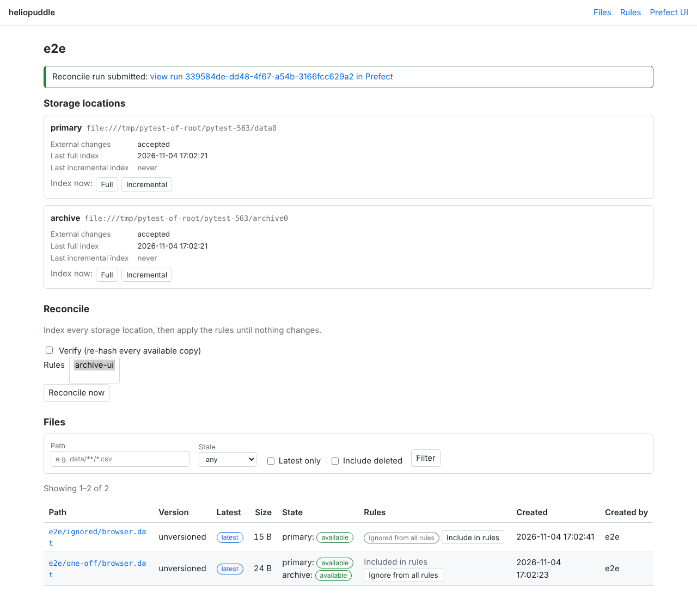

# M5 plan (approved): full reconciliation

## Context

M4 is merged (`main` at `ed173a3`). M5 adds `reconcile(project)`: one on-demand (or scheduled) Prefect flow run that brings a project's DB index and its storage locations fully into line with the rules.

A reconcile runs `index_full` on every storage location, optionally re-verifies content, then runs every enabled rule in full mode. A second reconcile with nothing changed in between makes no changes (SVC-06). An optional rule subset limits which rules run, and a small number of file failures does not stop a pass.

The building blocks exist from M3/M4: bounded index chains, rule full mode with cursors, guarded transfers and deletes, and per-storage-location and per-rule concurrency limits. M5 composes them into one run.

## Decisions (your answers marked ✔)

| # | Topic | Decision |
|---|---|---|
| C1 | Shape | One flow run, `reconcile(project, verify=False, rules=None)`. Each phase runs its chains **inline**: it loops index/rule batches with their continuation inside the reconcile run instead of scheduling successor runs. Batch limits still bound each batch, and progress is saved per batch as today. Between batches it waits `pause_between_runs`. Nothing new is queued or stored: no run tables. |
| C2 | Phases | **1. Index:** `index_full` for every active storage location, in config order. **2. Verify** (optional): see C4. **3. Rules:** every enabled rule (YAML and DB switch, R13) in full mode, in config order. Ignored files stay excluded. Disabled rules are skipped and logged.  **Rule subset:** an optional `rules: [names]` parameter limits the rule phase to those rules; all others are ignored. A name that doesn't exist is `422`, and a named disabled rule is skipped with a log line. Indexing and verify still cover every storage location. The default (`None`) is all rules. |
| C3 ✔ | Fixed point | The rule phase repeats until a whole pass changes nothing, up to `reconcile.max_rule_passes` (default 3). If rules are still changing things after the last pass (e.g. one copies what another deletes), the run fails and names those rules. This guarantees the second reconcile is a no-op. |
| C4 ✔ | Deep verify | With `verify=True`, after indexing, every `available` copy is re-hashed through the existing `verify_file` task, batched, holding the storage-location limit. A mismatch becomes `unknown`, as in M3 verify. Off by default because it reads everything. |
| C5 | "Changes" | Index: added, changed, removed, repaired, swept. Verify: copies marked `unknown`. Rules: copied, moved, deleted, plus conflicts newly marked `unknown`. Skips (same hash, newer, already conflicted) are not changes. The summary is logged with per-phase and per-rule counts; there is no artifact (as R17). |
| C6 | Concurrency | One reconcile per project: deployment concurrency 1 (`ENQUEUE`), plus `hp_concurrency("reconcile:
")`. Each index batch holds its storage-location limit and each rule batch its rule limit, as today. So scheduled index/rule runs and change triggers interleave safely with reconcile rather than overlapping it. |
| C7 | Failure | **Rule passes tolerate a few file failures.** A failed file (e.g. a locked file) does not interrupt a rule pass: it is recorded, and the pass goes on to the remaining files and rules.  - When the pass completes, the reconcile fails, listing every failed file with its rule and error.  - If failures reach `reconcile.max_failures` (default 5) during a pass, it fails at once.  - With any failure, the next fixed-point pass (C3) is not started.  **Index and verify phases** keep today's semantics: a failed batch or repair fails the reconcile, naming the phase and storage location.  Completed batches keep their progress, so a re-run resumes cheaply. A rule's full mode inside reconcile walks file ids inline, so continuing past a failed file never moves a persisted incremental watermark past it. |
| C8 ✔ | Triggers | `POST /projects/{p}/runs {kind: "reconcile", verify?, rules?}`. This returns `202` with the run link, or `409` naming the unfinished run (the same rule as manual rule runs). Also: the client's `reconcile(verify=False, rules=None)`, a **"Reconcile now"** form on the project page (verify checkbox, rule selection) with a Prefect link, and an optional cron. |
| C9 ✔ | Config | Project YAML `reconcile: {schedule: null, verify: false, rules: null, max_rule_passes: 3, max_failures: 5}`; every key is optional. `rules` is the scheduled runs' default subset. With no `schedule` the deployment is on-demand only. Deployment name `reconcile-p<pid>-<project>`; stale deployments are removed on start (SVC-13 pattern). `verify` is the scheduled runs' default. |

## Requirements in scope

| ID | Requirement |
|---|---|
| **SVC-06** | **Idempotent.** Reconcile is idempotent: with no external change in between, a second run makes no changes (C5 counts all zero), and the store and DB are identical before and after it. Verified even when rules are listed in an order that needs more than one pass (C3). |
| **SVC-26** | **Reconcile flow.** `reconcile(project, verify=False, rules=None)` runs the phases in C2 with inline chains (C1), including the rule subset. Disabled rules are skipped; the optional verify phase works as C4; the rule phase repeats to a fixed point (C3). It holds the C6 limits. |
| **SVC-28** | **Failure tolerance.** A rule pass continues past failed files and fails at the end of the pass, listing them all. It fails immediately when failures reach `reconcile.max_failures` (default 5), and starts no further pass after any failure (C7). |
| **SVC-27** | **Reconcile deployment.** One deployment per project, named as C9, with the optional cron from `reconcile.schedule`. Concurrency is 1 with `ENQUEUE`; duplicate deployments are rejected and stale ones removed on start. |
| **API-04** (amended) | **Runs endpoint.** `{kind: "reconcile", verify?: bool, rules?: [names]}` submits a run and returns `202 {flow_run_id, flow_run_url, deployment}`. A project with an unfinished reconcile run returns `409` naming that run. An unknown rule name returns `422`. |
| **CLI-10** | **Client.** `reconcile(verify=False, rules=None) -> RunInfo` wraps the endpoint and raises `HelioPuddleError` 409 when a reconcile is already unfinished. |
| **UI-08** | **UI.** The project page has a "Reconcile now" POST form (verify checkbox and a rule multi-select, all selected by default; same-origin protected). After posting, the page shows the submitted run's Prefect link. |
| **DEP-14** | **Config validation.** `reconcile` config is validated at startup (cron parses, `max_rule_passes` ≥ 1, `max_failures` ≥ 1, every name in `rules` exists) and fails fast. Defaults need no config. |

## Docs first (one commit, then push)

- `features.md`: M5 status and decisions C1–C9.
- Requirement texts above.
- `docs/design/rules.md`: replace "Reconcile (M5, not implemented)" with a full section; cross-link from `operations.md` and `indexing.md`.
- `docs/design/deployment.md`: the deployment.
- `docs/spec/reviews/m5-plan.md`.
- Start of milestone: restart the working branch from `main`; `uv lock --upgrade` + `scripts/check_deps.py`; set `milestone = "M5"` in `pyproject.toml`.

## Build (Sonnet agents, isolated worktrees, test-first, may ask me questions)

1. **Me: scaffold.**
   - `ReconcileConfig` in `config/models.py` (DEP-14).
   - Schemas: `ReconcileRunRequest`, `ReconcileSummary`.
   - An inline-chain hook in `services/index.py` (`_run` with successor scheduling suppressed, returning `remaining` and the next continuation) and in `services/rules.py` (`_batch` + `RuleContinuation`). Each is a small refactor that keeps current behaviour for normal runs.
2. **Agent A, engine (SVC-06, SVC-26, SVC-28).** `services/reconcile.py`, the `reconcile` flow:
   - phases;
   - fixed-point loop;
   - verify phase, reusing `services/verify.py` `verify_file`;
   - change counting from `IndexSummary`/`RuleSummary`;
   - limits via `hp_concurrency`.

   Unit tests with `flow.fn` and the `inline_prefect` fixture, no harness. They must include an adversarial rule order needing 2 passes, a non-converging pair failing after 3, bit rot caught only with `verify=True`, a rule subset that leaves other rules' files untouched, one locked file that fails at the end of a pass while the other files and rules complete, and `max_failures` reached causing an immediate failure with no further pass.
3. **Agent B, surface (SVC-27, API-04, CLI-10, UI-08).**
   - Deployment in `services/deploy.py`, reusing the rule-deployment naming and stale-removal pattern.
   - `services/runs.py` submit with the 409 check, reusing `rule_control`'s unfinished-run query.
   - `api/runs.py`, the client method and the UI form, reusing the index "Index now" pattern.
4. **Me: integrate,** then one Sonnet adversarial pass: reconcile racing uploads, triggers, a disable and a URL change, with `tests/adversarial.py` invariants.

## Verification

- ruff, pyright, `lint-imports`, `check_deps`.
- Unit tests: coverage ≥ 90%; durations reported; no unit test > 20s.
- Integration (real Prefect, Postgres, Azurite): reconcile on a two-location project with copy and delete rules in a two-pass order; a second reconcile has zero changes; a concurrent submission returns `409`; the cron deployment is registered.
- Docker e2e: the "Reconcile now" button.
- `req_matrix.py` OK for M5.
- Manual run:
  1. Zero-config start.
  2. Add files and an external change.
  3. Reconcile from the UI.
  4. Reconcile again: zero changes.
  5. Corrupt a file without changing its mtime: found only with verify.
- Then open a PR to `main` and ask you to test.

## Screenshot

"Reconcile now" on the project page: the verify checkbox and the rule picker
(all rules selected), and the notice linking to the submitted Prefect run.

